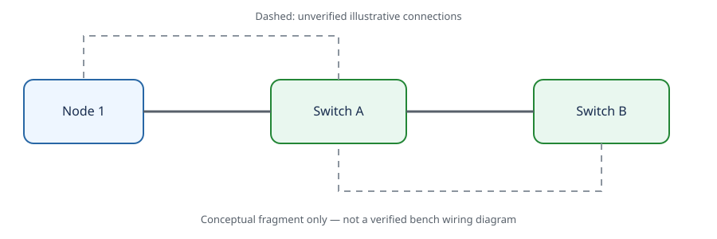

# Топология сети

## Модель

В доступном описании сеть представлена узлами и коммутаторами, соединёнными дуплексными линиями. Для линий задаются параметры скорости и длины. [РТО]

Топология описывается как граф:

- узлы — конечные устройства, участвующие в обмене;
- коммутаторы — промежуточные элементы коммутации;
- линии — соединения между портами устройств.

Это концептуальное представление модели, а не полная схема конкретного стенда.

## Схема

**[Реконструкция]** Схема показывает только иллюстративный фрагмент «узел — коммутатор — коммутатор». Пунктирные связи обозначают неизвестные или неподтверждённые соединения. Они не должны использоваться как фактическая конфигурация стенда.

## Параметры соединений

| Параметр | Значение в модели | Статус |
|---|---|---|
| Скорость канала | Настраиваемая | [РТО] |
| Длина линии | Учитывается | [РТО] |
| Дуплексность | Указана для линий | [РТО] |
| Задержка распространения | Численное значение и формула не приведены | [Требует проверки] |
| Буферизация и flow control | Не установлены | [Требует проверки] |

## Важное различие

Пересечение линий на плоском рисунке не означает, что узлы соединены. Соединение подтверждается только явной точкой/портом или описанием в исходной схеме. Само по себе пересечение линий также не является признаком deadlock.
