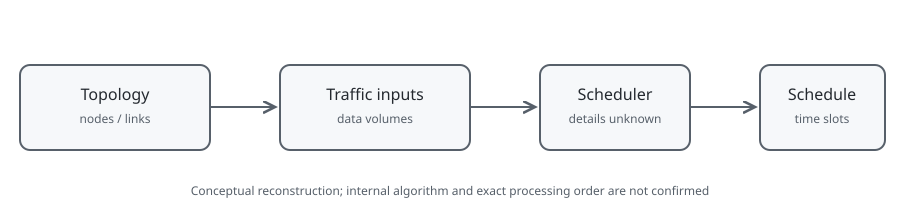

# Обзор расписания

Доступное описание указывает, что результатом работы сетевого планировщика является расписание передачи по временным слотам. [РТО]

## Концептуальная последовательность

Следующая последовательность — аналитическая схема [Реконструкция], а не подтверждённая последовательность внутренних вызовов программы:

1. Получение описания топологии.
2. Получение параметров линий и передаваемых объёмов данных.
3. Анализ ограничений совместного использования ресурсов.
4. Формирование расписания.
5. Представление результата пользователю.

## Неизвестные детали

- алгоритм планирования и его точное название;
- целевая функция/критерий оптимизации;
- ограничения на одновременные передачи;
- приоритеты и обработка конфликтов;
- длительность и семантика временного слота;
- формат сохранения или экспорта результата.

Эти детали не следует заполнять предположениями.
